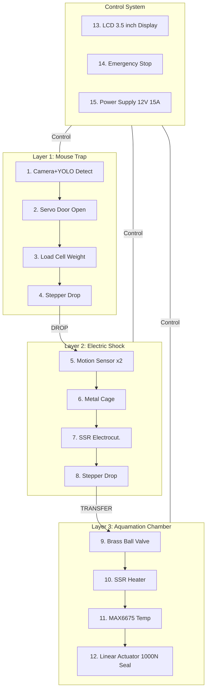

# Automatic Rat Aquamation Machine - Block Diagram

---

## Component Sequence Table

| Step | Layer | Component | Function |
|------|-------|-----------|----------|
| 1 | L1 | Webcam + Raspberry Pi + YOLO | Detect rat entry |
| 2 | L1 | Servo Motor | Open/close trap door |
| 3 | L1 | Load Cell + HX711 ADC | Weight verification |
| 4 | L1 | Stepper Motor | Transfer to Layer 2 |
| 5 | L2 | Motion Sensor (2x) | Detect cage movement |
| 6 | L2 | Metal Cage | Containment chamber |
| 7 | L2 | Solid State Relay | Activate electrocution |
| 8 | L2 | Stepper Motor | Transfer to Layer 3 |
| 9 | L3 | Brass Ball Valve | Regulate fluid flow |
| 10 | L3 | SSR + Heating Element | Heat processing liquid |
| 11 | L3 | MAX6675 Thermocouple | Temperature monitoring |
| 12 | L3 | BTS7960 + Linear Actuator 1000N | Push door for seal |
| 13 | Control | LCD 3.5" + Touch Screen | Display & interface |
| 14 | Control | Emergency Stop Button | Shutdown |
| 15 | Control | Power Supply 12V 15A | Main power |
