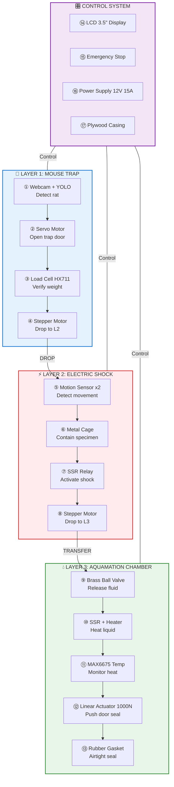

# Automatic Rat Aquamation Machine - Block Diagram

---

## Component Sequence Table

| Step | Layer | Component | Function |
|------|-------|-----------|----------|
| ① | L1 | Webcam + Raspberry Pi + YOLO | Detect rat entry |
| ② | L1 | Servo Motor | Open/close trap door |
| ③ | L1 | Load Cell + HX711 ADC | Weight verification |
| ④ | L1 | Stepper Motor | Transfer to Layer 2 |
| ⑤ | L2 | Motion Sensor (2x) | Detect cage movement |
| ⑥ | L2 | Metal Cage | Containment chamber |
| ⑦ | L2 | Solid State Relay | Activate electrocution |
| ⑧ | L2 | Stepper Motor | Transfer to Layer 3 |
| ⑨ | L3 | Brass Ball Valve | Regulate fluid flow |
| ⑩ | L3 | SSR + Heating Element | Heat processing liquid |
| ⑪ | L3 | MAX6675 Thermocouple | Temperature monitoring |
| ⑫ | L3 | BTS7960 + Linear Actuator 1000N | Push door for seal |
| ⑬ | L3 | Rubber Gasket | Airtight door seal |
| ⑭ | Control | LCD 3.5" + Touch Screen | Display & interface |
| ⑮ | Control | Emergency Stop Button | Shutdown |
| ⑯ | Control | Power Supply 12V 15A | Main power |
| ⑰ | Support | Plywood Casing 1/2" | Housing structure |
